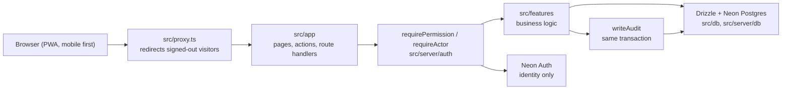

# Architecture

Version 1 is the foundation: sign-in, invitations, staff, roles and permissions, locations and an audit log. It has no restaurant workflows and no AI features.

Stack: Next.js 16 (App Router, `src/`), TypeScript, Tailwind CSS 4, Drizzle on Neon Postgres, Neon Managed Auth, Vitest, Playwright, hosted on Vercel.

## Overview

Neon Auth knows who the user is. The app decides what they may do. See [ADR 0001](decisions/0001-identity-neon-auth-app-permissions.md).

## Layers and folders

| Path | Responsibility |
|---|---|
| `src/proxy.ts` | Redirects signed-out visitors to `/sign-in`. Not authorization. |
| `src/app` | Routes only: `(public)` sign-in, invite, no-access; `(app)` hub, manager, owner. No business logic. |
| `src/components/ui`, `src/components/shell` | Design-system primitives; app shell, nav, experience switcher, offline banner. |
| `src/features/*` | Services and thin server actions: invitations, staff, roles, locations, audit, setup. |
| `src/server/auth` | Permission catalog and matrix, `Actor`, `loadActor`, `requirePermission`, guardrails, errors, session. |
| `src/server/audit` | `writeAudit`, called inside the caller's transaction. |
| `src/server/db` | Drizzle client, `withTransaction`, row locks. |
| `src/server/nav.ts` | Navigation filtered by the actor's permissions. |
| `src/db/schema`, `src/db/migrations` | Tables (one file per group) and generated SQL. |
| `scripts/setup-owner.ts` | One-time bootstrap of the first Owner (`npm run setup:owner`). |
| `tests/unit`, `tests/integration`, `tests/e2e` | Vitest unit, Vitest on a Neon test branch, Playwright. |

## Request flow

1. The proxy checks for a session. No session on a protected path: redirect to `/sign-in`.
2. The page, server action or route handler calls `requirePermission(permission, scope)` first (or `requireActor`).
3. The gate reads the Neon Auth session. No session throws `Unauthenticated`.
4. `loadActor` loads the active employee and their active role assignments from the database. Not an active employee throws `Forbidden`. Nothing is cached, so a suspension applies on the next request.
5. `hasPermission` checks the permission in the scope. Failure throws `Forbidden`.
6. Pages turn these errors into redirects (`/sign-in`, `/no-access`) through `requirePagePermission`.
7. The page or action calls a service in `src/features`. Services apply the guardrails and write the change and its audit row in one transaction.

See [permissions](permissions.md) for the catalog, matrix, scopes and guardrails.

## Data and conventions

- UUID primary keys, `created_at` / `updated_at` as `timestamptz` (UTC), `organization_id` on every table.
- No hard deletes. Inactive rows use a status field or `revoked_at` / `ended_at`. See [ADR 0002](decisions/0002-drizzle-migrations.md).
- Sign-in uses an email one-time code. Invitations are copyable links. See [ADR 0003](decisions/0003-email-code-sign-in-and-link-invites.md).

## Testing and delivery

- `npm run check` (typecheck, lint, unit tests) runs before every commit.
- Integration tests use `TEST_DATABASE_URL`, never `DATABASE_URL`.
- End-to-end tests are read-only checks as a signed-out visitor. Locally they run against `npm run start`. In CI they run on the Vercel deployment (`deployment_status` event, `E2E_BASE_URL`).

## Roadmap

Not built. Copied from the foundation spec, section 15. Items marked (connect) depend on an outside system.

- **Phase 1, before opening:** opening and closing checklists, food-safety temperature logs, compliance calendar with expiry alerts, recipe costing, order guides with par levels, training sign-off.
- **Phase 2, around opening:** role-based Today screens; POS connection (connect); daily flash report; manager shift log, waste and incident logs.
- **Phase 3, months 2 to 6:** inventory counts and actual-vs-theoretical food cost, prime-cost report, menu engineering, scheduling app connection (connect), QuickBooks sync (connect), review monitoring.
- **Later:** AI management agents (read-only first, people approve actions), catering, loyalty, additional locations.
